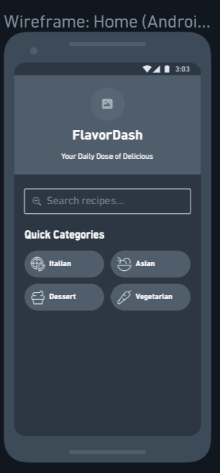
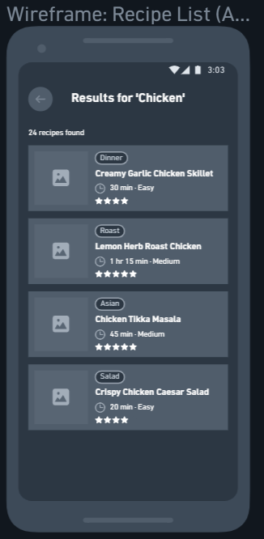
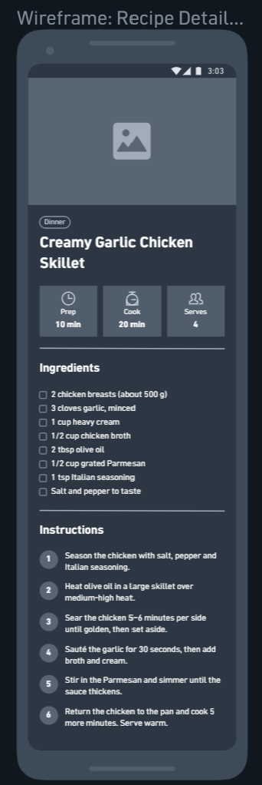

# FlavorDash UI Wireframes & Mockups

This directory contains the Phase 1 UI design progression for the **FlavorDash** React Native mobile application, moving from low-fidelity structural wireframes to high-fidelity styled screen mockups[cite: 10, 11, 12, 13, 14].

---

## Screen Overview

1. **Home Screen** — Features the FlavorDash branding, keyword search bar (`Search recipes...`), and color-coded Quick Category filter buttons (Italian, Asian, Dessert, Vegetarian)[cite: 7, 9, 12].
2. **Recipe List Screen** — Displays search/category results in a scrollable list of recipe cards with thumbnail previews, category tags, preparation time, difficulty level, and ratings[cite: 8, 10].
3. **Recipe Details Screen** — Presents the full meal breakdown with a header banner, Prep/Cook/Serves metadata cards, an interactive ingredient checklist, and numbered step-by-step cooking instructions[cite: 7, 11].

---

## Low-Fidelity Wireframes

| Home Screen | Recipe List | Recipe Details |
| :---: | :---: | :---: |
|  |  |  |

---

## High-Fidelity Mockups

| Home Screen | Recipe List | Recipe Details |
| :---: | :---: | :---: |
|  |  |  |
